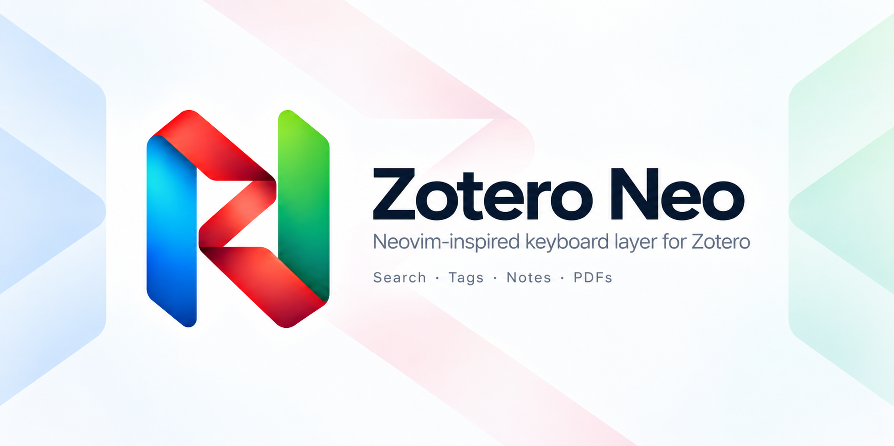

# Zotero Neo

Zotero Neo adds keyboard controls to Zotero. Find papers, select PDF text, make
annotations, and keep excerpts in existing notes while continuing to use
Zotero's own library, reader, and note editor.

The public release is [v0.1.0](https://github.com/zhongyangchuwu/Zotero-Neo/releases/tag/v0.1.0).
This documentation describes v0.2 development. Use the latest stable Zotero release.

## Get started

- [Install Neo and try it](docs/GETTING_STARTED.md).
- [Features](docs/FEATURES.md) — text selection, note capture, reading lists, and PDF navigation.
- [User guide](docs/USER_GUIDE.md) — workflows organized by module.
- [How Neo works](docs/CONCEPTS.md) — focus, modes, Cursor, and Selection.

## Help and reference

- [Troubleshooting](docs/TROUBLESHOOTING.md).
- [Commands and default keys](docs/COMMAND_REFERENCE.md).
- [Settings reference](docs/SETTINGS_REFERENCE.md).
- [Released v0.1.0 guide](https://github.com/zhongyangchuwu/Zotero-Neo/blob/v0.1.0/docs/USER_GUIDE.md) and [release notes](https://github.com/zhongyangchuwu/Zotero-Neo/releases/tag/v0.1.0).

## Development and project information

- [Development guide](docs/DEVELOPMENT.md) — build, debug, test, and edit the documentation.
- [Architecture](docs/ARCHITECTURE.md) and [interaction contract](docs/INTERACTION_MODEL.md).
- [Acceptance protocol](docs/V0_2_ACCEPTANCE.md) and [recording guide](docs/RECORDING_GUIDE.md).
- [Changelog](CHANGELOG.md), [roadmap](docs/ROADMAP.md), and [issue tracker](https://github.com/zhongyangchuwu/Zotero-Neo/issues).

## Provenance and license

The project began with code from
[Zotero Vim Plus](https://github.com/ZorroStardust/zotero-vim-plus), which incorporated
work from [zotero-vim](https://codeberg.org/finktank/zotero-vim).
Historical copyright notices are preserved under the project license.

[GNU Affero General Public License v3.0](https://github.com/zhongyangchuwu/Zotero-Neo/blob/main/LICENSE) (AGPL-3.0).
