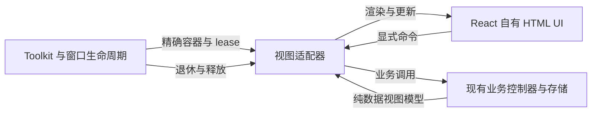

# UI 架构审查与 React 迁移边界

审查基线：`e84f16301dce5e93ee2ced72d088e4ef640f674a`。范围为 Settings、Picker、引用详情及必要的 React 挂载、主题、输入和凭据接缝；不是对全部 provider、原生宿主或安全面的穷尽审计。

本轮交付的是可运行设计样例、当前实机基线与审查结论，**没有把生产界面切换到 React**。视觉方向和渲染方式可以统一，但不能顺带改变设置提交、操作受理或 Reader 生命周期。

## 已有的可复用基础

- `src/ai-qa/ui/index.tsx:816-829` 已有 React `mount / update / dispose` 和幂等卸载。复用其技术边界，不扩展 AI 功能。
- `src/ai-qa/view-host.ts:13-40` 在加载前后核对精确 lease，向所属 Window 克隆 DTO，限制过期更新与命令，并处理死亡窗口。
- `src/main/window-runtime.ts:10-34` 已按 MainWindow 拥有设置、主题与清理；React 不应另建第二套窗口所有权。
- `src/ui/theme.ts:14-118,213-290` 已有主题变量、调色板及窗口级观察。引用浮层按 `root.ownerDocument.defaultView` 选择主题管理器（`src/reader/controller.ts:1959-1967`）。
- Picker 已有组合输入、查询版本、确认受理和清理协议；不应为更换渲染层重新实现这些规则。

## 发现与风险

### 1. 已确认缺陷：Settings 按钮不在 Tab 顺序中

**Medium；当前缺陷，不是迁移推测。**

`src/main/settings-ui.ts:10-16` 创建的共享按钮统一使用 `tabIndex=-1`。设置关闭与分区导航复用该 helper（`settings-center.ts:118-139`），而 `src/main/controller.ts:1041-1058` 没有完整的模态 Tab 边界。

在 Zotero 10.0.8 的本次独立截图实例中，外观页有 18 个可见按钮，0 个按钮可顺序 Tab 到达。将焦点置于设置标题后，通过 Gecko 测试输入事务发送 Tab，焦点从面板内 `h2` 转到面板外的 `post-upgrade-new-features-link`。这是软件输入验证，不代表物理键盘或 OS 输入法验收。

生产修复单独跟踪于 [#237](https://github.com/zhongyangchuwu/Zotero-Neo/issues/237)。普通控件应可聚焦；导航若使用 roving-tabindex，必须有完整的键盘实现；模态根还应拥有 Tab／Shift+Tab 边界，并保留 Escape、组合输入与关闭后焦点恢复。设计样例没有沿用全部按钮 `-1` 的约定，但这不意味着现有缺陷已经修复。

### 2. 迁移风险：把 React 根绑定到“当前活跃窗口”

**High；迁移风险，尚未发现因此发生的生产故障。**

`src/platform/ai-qa-ui.ts:94-153` 按原生 Window 加载运行时；`view-host.ts` 使用精确 lease 和 DTO／命令。引用控制器的来源窗口与展示窗口也可能不同，两个 Document 的寿命都参与清理（`src/references/controller.ts:244-275,293-355`）。

不能把这些边界替换成全局 `document`、最近活跃 Reader 或一个永久应用根。否则可能在替换后的 iframe 更新旧视图，或把操作发送到错误窗格。宿主继续创建正确 namespace 的容器；React 仅在该容器内渲染。Portal、样式和焦点都必须绑定精确 owner，不传递原始 Zotero／PDF／DOM 对象作为共享业务模型。

迁移验证：两个 Main、Reader 分屏、iframe 替换、运行时加载中关闭窗口；退休根不能再更新或 dispatch，活根只卸载一次。

### 3. 迁移风险：将 Reader 设置整体序列化为共享表单模型

**High；迁移风险，本审查没有发现已发生的凭据外泄。**

MinerU 现有控件会将已存 token 读入密码输入（`src/ui/mineru-credentials.ts:55-64,101-107`）；Semantic Scholar 控件则只查询配置状态，并使用 revision／disposed 防止迟到更新（`src/ui/reference-credentials.ts:58-80,97-129`）。现有 React 模型也明确排除已存模型密钥（`src/ai-qa/view-contracts.ts:67-93`）。

机械地复制现有输入值到 React state、DTO、表单快照或日志，会扩大已存密钥的可见范围。凭据应保留独立显式操作：展示模型只含 configured／pending／error；新输入短期存在，提交、取消和卸载时清除引用，不承诺 JavaScript 字符串可安全擦除。不能把凭据放进 Settings 总体 Save／Cancel 快照。

迁移验证：DTO／日志／错误不含原密钥；保存中切页或关闭不会晚到更新；忘记凭据只能来自显式操作，不能由 effect 重跑触发。

### 4. 迁移风险：把 Settings 当作已有的统一事务

**Medium；当前各页提交方式不同，不是一个已有的统一事务。**

- 交互与高级选项直接写偏好，主题编辑有自动保存（`settings-interaction.ts:91-101`、`settings-advanced.ts:117-130`、`settings-appearance.ts:427-446`）。
- 快捷键显式 Apply 并保留 dirty 编辑状态（`settings-keybindings.ts:151-188,201-215`）。
- 模块草稿属于页面，保存可能部分成功；切页会销毁并重建页面（`settings-modules.ts:58-60,173-210`、`settings-center.ts:216-220,256-264`）。
- 模块的 requested、启动时 applied 与 pendingRestart 是不同事实（`src/core/module-runtime.ts:45-83,165-203`）。

第一轮生产迁移应保留现有提交语义；需跨分区保留的草稿归 Settings 会话根，而非可卸载分区。若要统一保存／取消及回滚，必须另行确定行为和事务边界。工作台只演示会话草稿，模块分别显示草稿、已保存请求、本次应用与待重启，不能从样例反推生产已经支持统一回滚。

迁移验证：跨分区、语言更新和外部偏好通知时的 dirty 状态；部分保存失败不显示全部成功；保存请求不改写本次 applied 图。

### 5. 迁移风险：把卸载、过期展示与已受理操作合并成一个取消信号

**Medium；迁移风险，不是当前队列协议的缺陷。**

Picker 同步固定确认对象并单次受理，结果还受到 generation、sourceRevision、queryRevision 和 provider 身份约束（`src/main/picker/shell.ts:640-727,778-845`）。引用详情由 revision、AbortController 和 Reader snapshot 保护，刷新失败保留已有数据；缓存写入／清空另有串行队列和 generation（`src/references/controller.ts:288-323,724-819`、`src/references/cache.ts:171-227`）。

不能用组件单一 `isMounted` 或 effect cleanup 替代这些协议。卸载停止展示与订阅；已受理的领域操作是否继续由其业务策略决定。保留现有控制器和队列，只替换 DOM 投影，不顺手增加重试或新的取消协议。

迁移验证：查询逆序完成、切源、关闭重开、Reader 来源退休、缓存清空与在途请求竞争、重复 Enter，以及刷新失败时的数据与来源保留。

## 建议边界

以下是迁移建议，不是本轮新增的生产框架：

**留在 React 外：** 原生 Window／Document／Reader 身份、全局按键和 IME 仲裁、偏好及观察、快捷键验证、模块启动图、provider 与操作受理队列、参考文献服务／缓存／网络／文库修改、凭据存储和长期任务寿命。

**React 可拥有：** 布局、按钮／字段／状态等小型组件、短期交互状态及会话根明确拥有的草稿。继续使用同一主题政策；只映射现有 token，不建立第二套主题状态、router 或全局 Store。工作台 CSS 只用于独立网页，不能把它的页面级 reset 直接注入 Zotero。

## 迁移次序

1. **Settings**：保留宿主与写入策略，先迁普通非凭据分区，明确可达性和草稿寿命。
2. **Picker**：保留 provider、输入仲裁、查询与受理 runtime，只替换搜索／列表／预览投影。
3. **Reference details**：先迁只读元数据及来源展示，再接现有刷新／清除命令；来源 lease、定位和文库操作仍由控制器拥有。

本轮已运行设计样例的保存／取消、模块请求、Picker 键盘／组合事件、参考错误／清除等路径，另采集当前实机界面并复现发现 1。其余迁移验证项尚未执行，不能视为生产切换已获验收。
